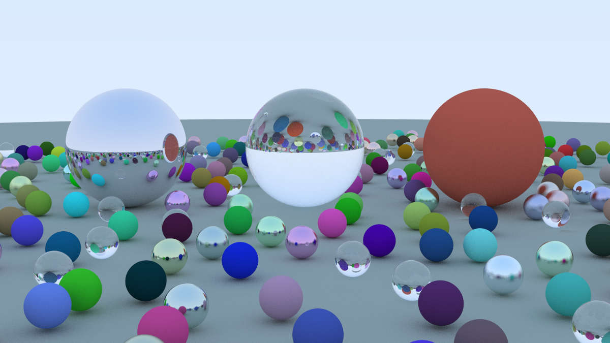
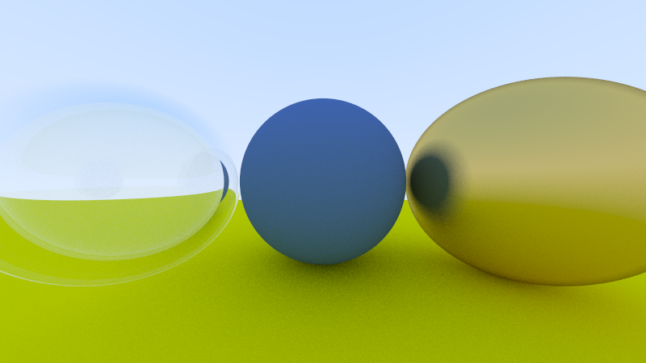
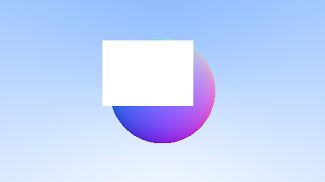

# raytracer

[](https://github.com/NizarAlmonajjed/raytracer/actions/workflows/ci.yml)

A CPU path tracer written from scratch in modern C++17: no graphics libraries,
just vector maths, the standard library and `std::thread`. It renders diffuse,
metal and glass materials with anti-aliasing, scales across all CPU cores, and
uses a bounding volume hierarchy (BVH) to stay fast with hundreds of objects.



*`--scene random --width 1200 --samples 200 --threads 8`: 479 spheres, rendered in 16.97 s on an Apple M3.*

## Features

- **Materials:** Lambertian (diffuse), metal with adjustable fuzz, and glass
  with Snell's-law refraction, total internal reflection and Schlick's
  Fresnel approximation
- **Path tracing:** recursive light bounces with a configurable depth limit,
  soft shadows, gamma correction
- **Camera:** positionable (look-from / look-at / up), adjustable field of
  view, anti-aliasing by averaging random samples per pixel
- **Multithreading:** image rows handed out to `std::thread` workers through
  an atomic counter; output is **bit-identical for any thread count**
- **BVH acceleration:** median-split bounding volume hierarchy built with
  `std::nth_element`; **5.3x faster** than a flat object list on a 479-sphere scene
- **Tested:** 112 GoogleTest unit tests covering vector maths, intersections,
  materials, the BVH (checked against brute force on 20,000 random rays) and
  thread-count determinism; threading verified race-free with ThreadSanitizer
- **CI:** GitHub Actions builds and runs all tests on Ubuntu (GCC) and macOS (Clang)

## Performance

All timings measured on an **Apple M3** (4 performance + 4 efficiency cores),
`RelWithDebInfo` build (`-O2`), median of 3 runs, render only.
Full data and methodology: [BENCHMARKS.md](BENCHMARKS.md).

**Random scene (479 spheres), 400x225, 100 samples/pixel, max depth 50**

| Configuration              | Render time | Speedup |
|----------------------------|------------:|--------:|
| 1 thread, no BVH           | 19.404 s    | 1.0x    |
| 1 thread, BVH              | 4.418 s     | 4.4x    |
| 8 threads, no BVH          | 4.576 s     | 4.2x    |
| **8 threads, BVH**         | **0.864 s** | **22.5x** |

**Thread scaling (materials scene, 800x450, 200 samples/pixel; measured before the BVH was added)**

| Threads | Render time | Speedup |
|--------:|------------:|--------:|
| 1       | 14.505 s    | 1.00x   |
| 4       | 3.887 s     | 3.73x   |
| 8       | 2.782 s     | 5.21x   |

Scaling is near-linear up to the 4 performance cores; threads 5 to 8 run on
the M3's slower efficiency cores, so they add less.

On a tiny scene (5 spheres) the BVH is about 1.3x *slower* than the flat list:
its box tests and extra virtual calls cost more than testing 5 spheres directly.

## Gallery

| Materials scene | Surface normals (milestone 2) |
|---|---|
|  |  |
| `--scene materials --width 800 --samples 200` (4.18 s, 8 threads) | Normals mapped to RGB, a common debugging view |

## Building

Requirements: a C++17 compiler (Clang or GCC) and CMake 3.20+.
GoogleTest is downloaded automatically by CMake.

```sh
git clone https://github.com/NizarAlmonajjed/raytracer.git
cd raytracer
cmake -S . -B build -DCMAKE_BUILD_TYPE=Release
cmake --build build --parallel
ctest --test-dir build --output-on-failure
```

On macOS: `xcode-select --install` and `brew install cmake`.

## Usage

Run from the project root (output goes to `renders/`):

```sh
./build/raytracer                                   # materials scene, 400 px, all cores
./build/raytracer --scene random --width 1200 --samples 200
./build/raytracer --scene random --threads 1 --no-bvh  # the slow baseline
open renders/random.ppm                             # macOS Preview opens PPM files
```

```
Usage: raytracer [options]
  --scene NAME  scene to render: materials, random (default materials)
  --width N     image width in pixels (default 400)
  --samples N   rays per pixel (default 100)
  --depth N     max bounces per ray (default 50)
  --threads N   worker threads (default: number of hardware threads)
  --no-bvh      test every object for every ray (for benchmarking)
  --output PATH output PPM file (default renders/<scene>.ppm)
  --help        show this message
```

## How it works

```
for each pixel (rows shared between threads):
    for each sample:
        ray = camera ray through a random point inside the pixel
        colour += trace(ray)
    pixel = colour / samples

trace(ray, depth):
    hit = world.hit(ray)              # BVH: skip whole subtrees whose box is missed
    if no hit: return sky colour      # the sky is the only light source
    scattered, attenuation = hit.material.scatter(ray, hit)
    return attenuation * trace(scattered, depth - 1)
```

## Design notes

- **Polymorphism where it pays.** `Hittable` (spheres, lists, BVH nodes) and
  `Material` (Lambertian, Metal, Dielectric) are abstract base classes with
  virtual functions, so new shapes and materials plug in without touching the
  renderer. Concrete classes are `final`.
- **Explicit ownership.** Scene objects and materials are owned by
  `std::shared_ptr`; per-hit records borrow the material through a raw
  `const Material*`, which avoids millions of atomic reference-count updates
  in the hot loop.
- **Lock-free rendering.** Threads only read the scene (all hit and scatter
  methods are `const`) and each writes only its own rows, so the render loop
  needs no mutexes. The one shared variable is a `std::atomic<int>` row
  counter, which also balances the load (expensive rows don't stall a thread).
- **Deterministic randomness.** Each thread has its own `std::mt19937`
  (`thread_local`), reseeded at the start of every row from the row index, so
  the image doesn't depend on which thread rendered which row. This makes
  "same output, faster" a testable property of every optimisation.
- **RAII everywhere.** Files close themselves, memory frees itself, and an
  RAII guard joins worker threads even if an exception is thrown.
- **`std::optional` for "maybe" results.** Intersections return
  `std::optional<HitRecord>` instead of magic values like `t = -1`.

## Project layout

```
include/rt/   headers: vec3, ray, hittable, sphere, bvh, aabb, material, camera, ...
src/          implementations and main.cpp
tests/        GoogleTest unit tests
renders/      output images
BENCHMARKS.md measured timings and methodology
```

## Possible next steps

- Surface-area-heuristic (SAH) BVH splits and front-to-back child traversal
- Flatten the BVH into a contiguous array to improve cache behaviour
- SIMD (e.g. 4-wide ray-box tests) and a tile-based work queue
- Write PNG output directly (e.g. stb_image_write); PNGs here were converted
  from PPM with macOS `sips`
- More shapes (planes, triangles, meshes) and emissive lights

## Acknowledgements

The overall approach follows Peter Shirley's
[*Ray Tracing in One Weekend*](https://raytracing.github.io/) series; the code
here is an independent implementation with its own structure, tests,
multithreading and benchmarks.
